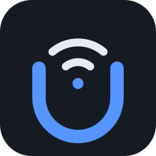

# UniLink

**One connection. Three platforms.**

Automatic university captive portal sign-in and session maintenance.

[Downloads](#download) · [Documentation](docs/README.md) · [فارسی](README_FA.md) · [Releases](https://github.com/metasina3/UniLink/releases)

UniLink signs you in to university captive portals and keeps your session connected. It supports Windows, macOS, and Android. The default campus network is Urmia University's `UUWN`.

## Download

Choose your platform below. [Browse all releases](https://github.com/metasina3/UniLink/releases) or [open the latest bundle](https://github.com/metasina3/UniLink/releases/latest). Android 1.14.1 is also available directly from its developer.

| Platform | Version | Download | Guide |
| --- | --- | --- | --- |
| Windows 10 (2004+) and Windows 11, x64 | 1.4.0 | [UniLink.exe](https://github.com/metasina3/UniLink/releases/download/bundle-2026.11.22/UniLink.exe) | [Windows user guide (Persian)](docs/README_FA.html) |
| macOS 12+ | 1.3.1 | [DMG](https://github.com/metasina3/UniLink/releases/download/bundle-2026.11.22/UniLink-1.3.1-macOS.dmg) · [ZIP](https://github.com/metasina3/UniLink/releases/download/bundle-2026.11.22/UniLink-1.3.1-macOS.zip) | [macOS guide](docs/MACOS_GUIDE.md) |
| Android 8+ | 1.14.1 | [APK](https://github.com/Mrzzan05/UniLink-Android/releases/download/v1.14.1/UniLink-v1.14.1.apk) | [Android guide](src/UniLink.Android/README.md) |

- **Windows** — Run `UniLink.exe` directly. The standalone executable includes the .NET runtime. To update, exit the previous app before replacing its executable. Connection shows the active account’s data left out of its total allowance. Use Check data in Accounts to refresh a saved account.
- **macOS** — Open the DMG and drag `UniLink.app` to Applications.
- **Android** — Open the signed APK to install or update. Version 1.14.1 fixes the home-screen widget Connect/Pause action. [Release notes](https://github.com/Mrzzan05/UniLink-Android/releases/tag/v1.14.1).

[All releases](https://github.com/metasina3/UniLink/releases) · [Earlier Android releases](https://github.com/Mrzzan05/UniLink-Android/releases)

## Highlights

- Automatic portal sign-in and session maintenance.
- Multiple saved accounts and account rotation on supported editions.
- Physical-interface routing and portal certificate verification (see platform documentation for limitations).
- Remaining-data display on Windows and Android.

## Source and builds

All editions live on `main`. Each has its own source, build, and release version.

| Edition | Source | Build from the repository root |
| --- | --- | --- |
| Windows | [Windows app](src/UniLink.Windows) · [.NET core](src/UniLink.Core) · [Tests](tests/UniLink.Tests) | `./build.ps1` with PowerShell and the .NET 8 SDK |
| macOS | [Swift app and Python tools](src/UniLink.macOS) · [Tests](tests/UniLink.macOS.Tests) | `./src/UniLink.macOS/build-swift.sh` with Xcode Command Line Tools |
| Android | [Gradle project](src/UniLink.Android) | Run `./gradlew assembleDebug` in `src/UniLink.Android` with JDK 17 and Android SDK 35 |

[Release instructions](docs/RELEASING.md) · [Protocol reference](docs/PROTOCOL.md) · [Windows network behavior](docs/NETWORK_BEHAVIOR.md)

## Project documentation

| Resource | Purpose |
| --- | --- |
| [Documentation index](docs/README.md) | Guides, protocol, testing and release procedures |
| [Windows changelog](docs/CHANGELOG.md) | Desktop release history and Android update pointer |
| [Android changelog](src/UniLink.Android/CHANGELOG.md) | Android release history |
| [Android synchronization](docs/ANDROID_SYNC.md) | Upstream source, local integration and signed APK provenance |
| [Issues](https://github.com/metasina3/UniLink/issues) | Bug reports and feature requests |

## Contributors

| GitHub account | Contribution |
| --- | --- |
| [@metasina3](https://github.com/metasina3) | Windows development and repository maintenance |
| [Matin Sojoudi (@Matinsojoudi)](https://github.com/Matinsojoudi) | Native Swift app for macOS |
| [@Mrzzan05](https://github.com/Mrzzan05) | Android development |

## Licenses

Windows and macOS use the [MIT license](LICENSE). Android uses [GNU GPL v3 or later](src/UniLink.Android/LICENSE). Windows third-party notices are included in the executable and available in [notices](notices).

UniLink is an independent project. Use it with accounts you are authorized to use and follow your institution's network policy.
